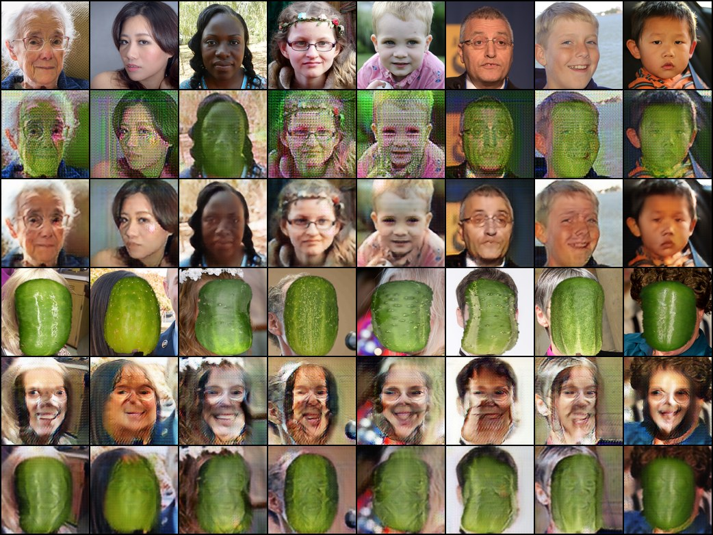
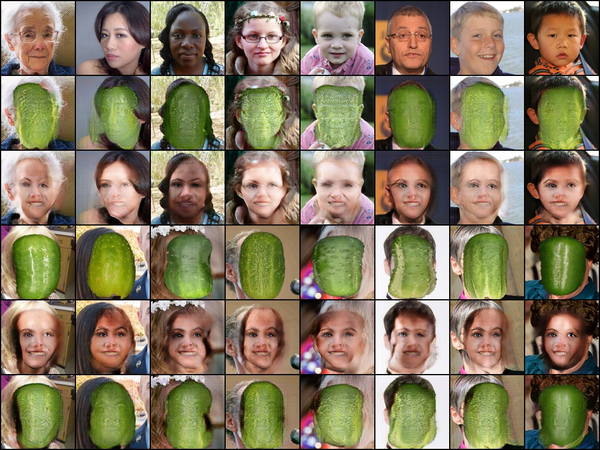
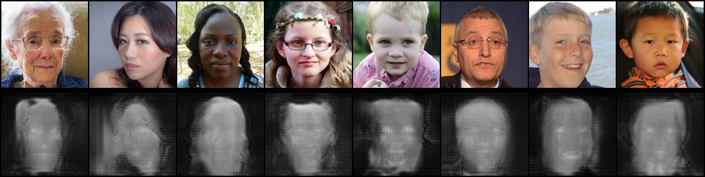
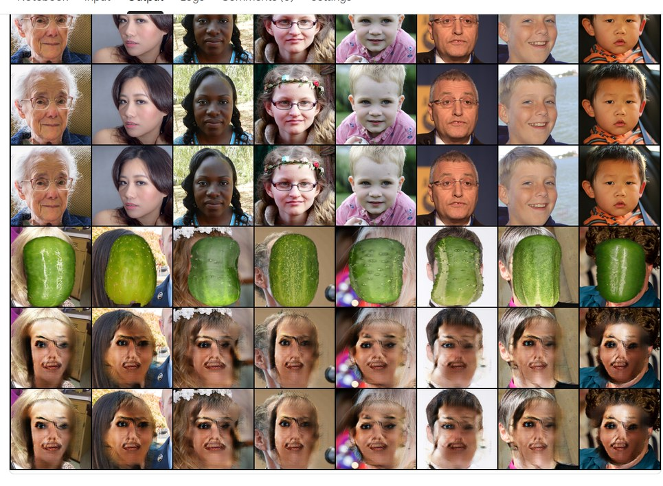
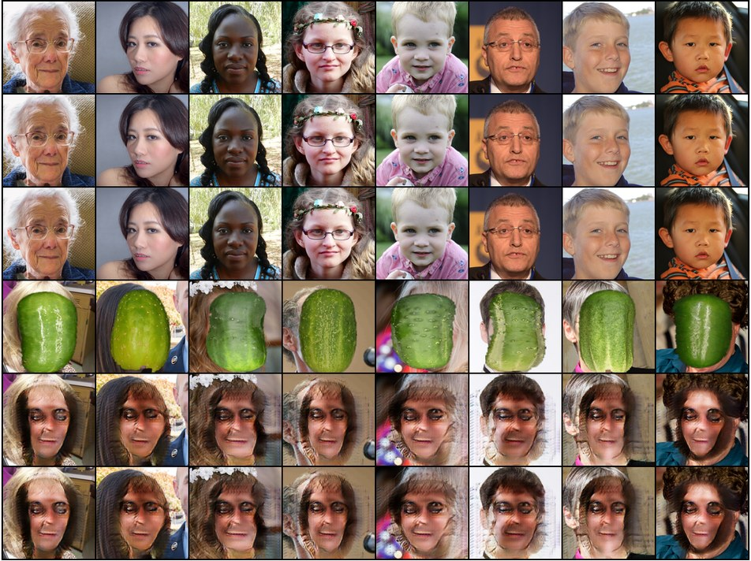
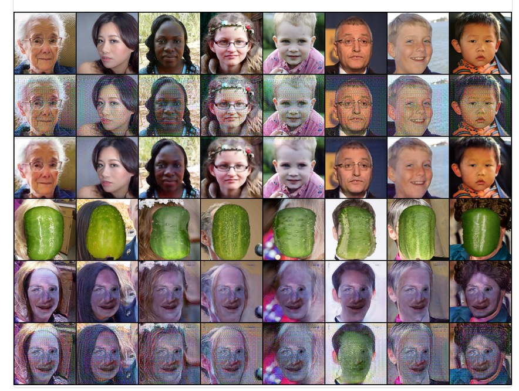
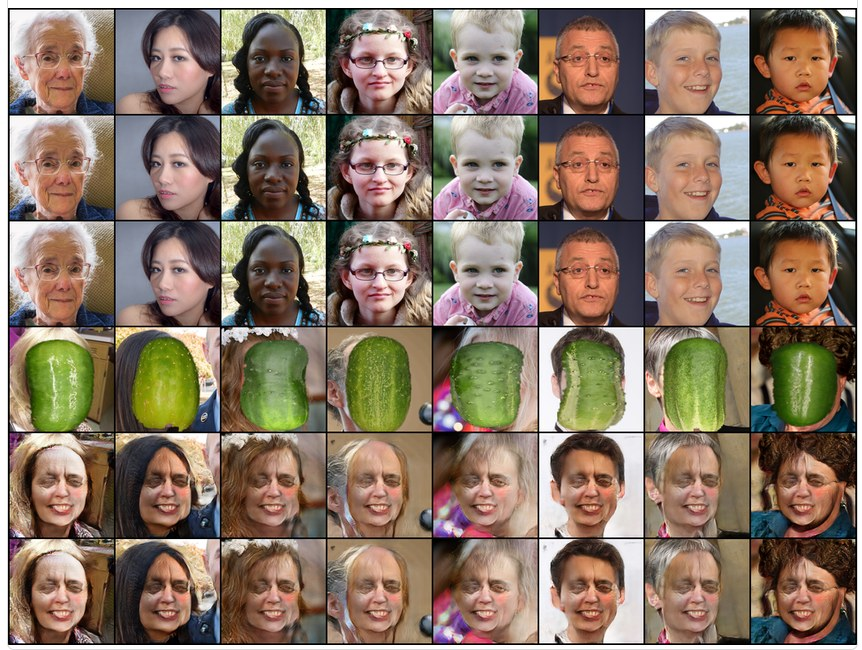

# CucuGAN: Experiment-Log

Was wurde ausprobiert, was kam heraus, was wurde entschieden. Alle Einstellungen eines Laufs stehen
zusätzlich in `outputs/<name>/config.json` und in jedem Checkpoint, die eines Datensatzes in
`build_config.json`. Ausgewählte Kontrollbilder liegen in `docs/experiments/`.

**Kontrollbilder lesen** (8 feste Testbilder, je Zeile): 1 echtes Gesicht · 2 → Gurkengesicht ·
3 → zurück zum Gesicht · 4 echte Collage · 5 → „Gesicht“ · 6 → zurück zur Collage.
**Maskenbild** (bei `--attention`): oben Testgesichter, darunter die Maske von G_AB
(hell = wird zu Gurke, dunkel = bleibt original).

## Übersicht

| # | Lauf | Daten | Änderung gegenüber dem Vorgänger | Umfang | Ergebnis (kurz) |
|---|---|---|---|---|---|
| 1 | `overfit` | Schalenquadrate | erster Test | 20 Bilder, 800 Schritte, CPU | lernt; ganzes Bild wird Gurkentextur, Gesicht nur als Relief, Haare/Hintergrund weg |
| 2 | `overfit_umgebung` | 22 Gurkenfotos mit Umgebung | andere Gurkendomäne | wie 1 | Haare bleiben, Gesicht grün, Umgebung teils grünstichig |
| 3 | `overfit_collage` | 22 Collagen 50×70 | andere Gurkendomäne | wie 1 | grün gezielt am Gesicht, Haare/Hintergrund meist original → **Collage gewählt** |
| 4 | `overfit_gpu` | `collage50_128` | auf Kaggle-GPU | 20 Bilder, 4.000 Schritte | stabil, Gesicht wird grünes Oval |
| 5 | `amp_test` | `collage50_128` | `--amp` | 200 Bilder, 1.000 Schritte | Mixed Precision stabil |
| 6 | `baseline` | `collage50_128` | volles Training, Paper-Standard | 200 Epochen | Gurke **übergeklebt**, Gesicht unsichtbar versteckt (Steganografie) |
| 7 | `struct_test` | `collage128` (66×86) | `--lambda-struct 10 --cycle-noise 0.1` | 20 Epochen | kein Überkleben mehr, Gesicht grün mit Zügen; Hintergrund grünlich, Gittermuster, pinke Augen |
| 8 | `test_struct_att` | `collage128` | `--attention` | 20 Epochen | „nichts tun“-Falle: Maske meist zu, schaukelt zwischen unverändert und grün |
| 9 | `A_struct5` | `collage128` | ohne Attention, λ_struct 5 | 20 Epochen | Züge erkennbar, aber ganzes Bild verrauscht und bunt gesprenkelt |
| 10 | `B_att_struct3_cyc5` | `collage128` | Attention, λ_struct 3, λ_cycle 5 | 20 Epochen | **Maske findet das Gesicht**, echte Gurkenschale, Haare/Hintergrund sauber; Gesichtszüge fast weg |
| 11 | `C_att_struct5_cyc5` | `collage128` | Attention, λ_struct 5, λ_cycle 5 | 20 Epochen | „nichts tun“: Gesichter unverändert |
| 12 | `D_att_struct6_cyc7` | `collage128` | Attention, λ_struct 6, λ_cycle 7 | 20 Epochen | „nichts tun“: Gesichter unverändert |
| 13 | `B_full_att_struct3_cyc5` | `collage128` | Einstellungen von #10, volles Training | 200 Epochen | keine Gurke mehr: Gesicht mit buntem Rauschmuster (verstecktes Kodieren) |
| 14 | `B_full_att_struct4_cyc5` | `collage128` | wie #13, λ_struct 4 (zwischen offen und „nichts tun“) | 200 Epochen | „nichts tun“: Gesichter unverändert |

## Details

### 1–3: Welche Gurkenbilder? (CPU-Overfit-Tests)
Je 20 gleiche Gesichter, 40 Epochen, kein Image-Pool, nur die Gurkenbilder verschieden.
- **Schalenquadrate** (Ausschnitte nur aus der Gurkenschale): Der Diskriminator kennt nur Schale ohne
  Umgebung, also wird alles zu Schale, auch Haare und Hintergrund.
- **Gurken in Umgebung** (Wikimedia Commons, von Hand ausgewählt): Haare bleiben, Umgebung wird
  teils grünlich.
- **Collagen** (Jin-Gurke auf die Gesichtsposition eines FFHQ-Porträts montiert): Haare, Hals und
  Hintergrund sind in beiden Domänen gleich verteilt, nur Gesicht vs. Gurke unterscheidet sich.
  Prinzip wie horse2zebra.

**Entscheidung:** Collagen.

### 4–5: GPU und Mixed Precision (Kaggle T4)
- Overfit-Test mit 200 Epochen: 19 min, stabil.
- Geschwindigkeit (128 px, Batch 1): 32 Bit 0,136 s/Schritt, `--amp` 0,118 s/Schritt, im langen
  Lauf 0,086 s/Schritt. Mixed Precision bringt nur ~13 %, weil die GPU bei Batch 1 vor allem
  Verwaltungsarbeit macht.

**Entscheidung:** `--amp` für alle weiteren Läufe.

### 6: Baseline
Collage 50×70 %, Paper-Standard, 200 Epochen, ~7 h.
- Haare und Hintergrund perfekt erhalten.
- Der Generator klebt eine Gurke über das Gesicht, keine Gesichtszüge sichtbar.
- Trotzdem fast perfekte Rekonstruktion: Das Gesicht wird unsichtbar in der Gurke versteckt
  (Chu et al. 2017, *CycleGAN, a Master of Steganography*). Ursache: Collagen haben keine
  Gesichtszüge, und der Cycle-Loss prüft nur, ob man zurückrechnen kann, nicht, ob man etwas sieht.

**Entscheidung:** Gurke größer (66×86 %, ganzes Gesicht bedeckt), Struktur-Loss und Rauschen gegen
das Verstecken.

### 7: Struktur-Loss + Rauschen
`--lambda-struct 10 --cycle-noise 0.1`, 20 Epochen.
- Kein Überkleben mehr: Gesichter werden grün, Augen, Brille, Nase und Mund bleiben sichtbar.
- Hintergrund und Haare werden grünlich, feines Gittermuster über dem ganzen Bild, pinke Flecken
  um die Augen.

**Entscheidung:** Attention gegen den grünen Hintergrund.

### 8: + Attention
Wie 7, zusätzlich `--attention`.
- Die Maske bleibt meist zu, Zeile 2 ist fast identisch mit dem Original. In einzelnen Epochen
  werden die Gesichter flächig grün, in der nächsten ist es wieder weg.
- Ursache: Mit Attention ist „nichts tun“ trivial (Maske 0), Cycle-, Identity- und Struktur-Loss
  sind dann exakt 0. Nur der GAN-Loss spricht dagegen.

**Entscheidung:** Bremsen lockern (λ_struct, λ_cycle kleiner), mit und ohne Attention vergleichen.

### 9–10: Doppel-Kurztest auf zwei GPUs
Gleichzeitig auf Kaggle (je eine T4), je 20 Epochen, `--amp --cycle-noise 0.1`.

**A_struct5** (ohne Attention, λ_struct 5): Gesichtszüge erkennbar, aber das ganze Bild ist
verrauscht und bunt gesprenkelt, Haare und Hintergrund leiden.

**B_att_struct3_cyc5** (Attention, λ_struct 3, λ_cycle 5):
- Die Maske ist hell am Gesicht, dunkel an Haaren, Hintergrund, Kleidung. Das Netz hat selbst
  gelernt, wo das Gesicht ist.
- Zum ersten Mal echte Gurkenschale mit Noppen und Streifen im Gesicht.
- Haare und Hintergrund sauber.
- Gesichtszüge fast verschwunden (λ_struct 3 zu locker). Die Maske hat ein leichtes Gittermuster
  (Hinweis auf das Schachbrett von `ConvTranspose2d`).

**Entscheidung:** Attention behalten. Mitte suchen zwischen #8 (λ_struct 10, λ_cycle 10: tut nichts)
und #10 (λ_struct 3, λ_cycle 5: Gesicht weg). Nächster Doppel-Kurztest:
`C_att_struct5_cyc5` und `D_att_struct6_cyc7`.

### 11–12: Mitte zwischen #8 und #10
Doppel-Kurztest, beide mit Attention.

**C_att_struct5_cyc5** und **D_att_struct6_cyc7**: Beide fallen in die „nichts tun“-Falle, Zeile 2
ist praktisch identisch mit dem Original. Die Rückrichtung (Collage → Gesicht, Zeile 5) malt dagegen
deutlich Gesichter in die Gurke: G_BA arbeitet, nur G_AB bleibt untätig.

**Erkenntnis:** Mit Attention gibt es eine scharfe Kippstelle. Schon ab λ_struct 5 ist „Maske zu“
günstiger als jede Änderung. Nur mit sehr lockeren Bremsen (#10) öffnet sich die Maske, dann gehen
aber die Gesichtszüge verloren. Feineres Drehen an λ_struct allein findet vermutlich keinen guten
Mittelweg.

**Entscheidung:** Kein weiteres Feintuning, sondern die funktionierende Variante #10 voll trainieren
(#13), parallel auf der zweiten GPU mit λ_struct 4 (#14). Kontrollbilder jeder Epoche und Checkpoints
alle 10 Epochen erlauben, den besten Stand auszuwählen, falls die Gesichtszüge später verschwinden.

**Ideen für später**, falls die vollen Läufe nicht reichen:
- **Struktur-Aufwärmphase** (`--struct-warmup`): erst lockere Bremsen wie #10 (Maske lernt, wo das
  Gesicht ist), dann λ_struct langsam erhöhen, damit die Gesichtszüge zurückkommen.
- **Masken-Loss** (`--mask-target`, `--lambda-mask`): bestraft eine Maske, die im Mittel kleiner als
  ein Zielwert (~0,4, Fläche der Gurke in den Collagen) ist. Gibt nicht vor, *wo* die Maske offen
  ist, nur *wie groß* sie ungefähr ist. Verhindert die „nichts tun“-Falle.
- **Resize-Upsampling** gegen das Gittermuster in der Maske (Patch `outputs/patches/attention_plus_upsample.diff`).

### 13–14: Volle Läufe mit Attention
Parallel auf zwei T4, je 200 Epochen.

**B_full_att_struct3_cyc5:** Die nach 20 Epochen offene Maske mit Gurkenschale (#10) hat sich nicht
gehalten. Nach 200 Epochen bleibt das Gesicht erhalten, aber mit einem feinen bunten Rauschmuster
überzogen, keine Gurke. Das Muster ist vermutlich wieder verstecktes Kodieren: Der Generator gewinnt
gegen den Diskriminator über unsichtbare Feinmuster statt über echte Gurkenschale. In Zeile 6 wird
aus der Collage beim Rückweg ebenfalls keine Gurke mehr.

**B_full_att_struct4_cyc5:** „Nichts tun“, Gesichter unverändert (wie #11, #12).

**Erkenntnis:** Mit Attention gibt es nur „Maske zu“ oder einen instabilen Zustand, der im langen
Training in Rauschmuster kippt. Feintuning der λ hilft nicht mehr. Nächster Schritt: das Problem
direkt angehen (Masken-Loss) oder ein anderes Verfahren (CUT, ohne Rückweg, also ohne
verstecktes Kodieren).
